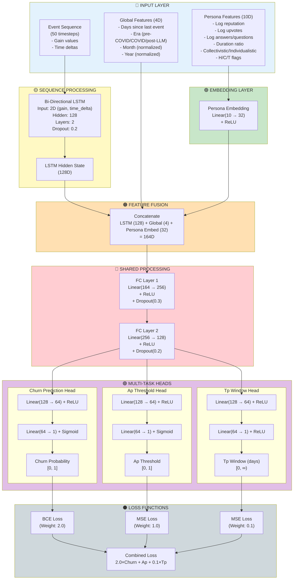
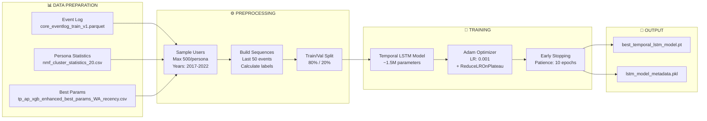
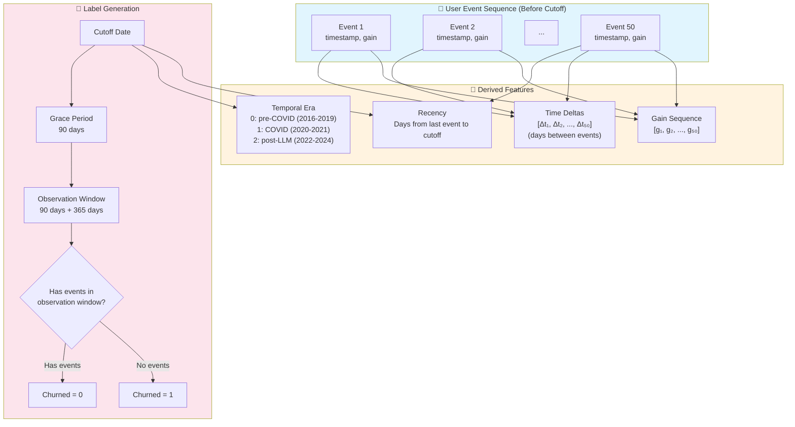

# LSTM Temporal Ap/Tp Prediction - Architecture Diagram

## Overview

This document visualizes the architecture of the Temporal LSTM model for Dynamic Ap/Tp Prediction as implemented in [lstm_temporal_ap_tp.py](lstm_temporal_ap_tp.py).

---

## Complete Model Architecture



---

## Data Flow (Training Pipeline)



---

## Temporal Feature Engineering



---

## Model Input/Output Summary

### Inputs

| Input Type | Dimension | Description | Source |
|------------|-----------|-------------|--------|
| **Event Sequence** | `(batch, 50, 2)` | Gain values + time deltas for last 50 events | Event log |
| **Global Features** | `(batch, 4)` | Days since last event, era, month, year | Temporal context |
| **Persona Features** | `(batch, 10)` | Persona statistics (reputation, upvotes, etc.) | NMF cluster stats |

### Outputs

| Output | Dimension | Range | Activation | Loss Function |
|--------|-----------|-------|------------|---------------|
| **Churn Probability** | `(batch, 1)` | [0, 1] | Sigmoid | BCE (weight: 2.0) |
| **Ap Threshold** | `(batch, 1)` | [0, 1] | Sigmoid | MSE (weight: 1.0) |
| **Tp Window (days)** | `(batch, 1)` | [0, ∞) | ReLU | MSE (weight: 0.1) |

---

## Key Hyperparameters

```python
SEQUENCE_LENGTH = 50        # Number of recent events
PERSONA_EMBED_DIM = 32      # Persona embedding dimension
LSTM_HIDDEN = 128           # LSTM hidden size
NUM_LSTM_LAYERS = 2         # Number of stacked LSTM layers
BATCH_SIZE = 256            # Training batch size
LEARNING_RATE = 0.001       # Initial learning rate
NUM_EPOCHS = 50             # Maximum epochs
GRACE_DAYS = 90             # Grace period for churn label
```

---

## Training Strategy

### Multi-Task Loss Weighting

The model uses a weighted combination of losses:

```
Total Loss = 2.0 × BCE(Churn) + 1.0 × MSE(Ap) + 0.1 × MSE(Tp)
```

**Rationale:**
- **Churn prediction** (weight 2.0): Primary task, most important
- **Ap threshold** (weight 1.0): Secondary task, important for threshold optimization
- **Tp window** (weight 0.1): Tertiary task, less critical (scaled down for numerical stability)

### Regularization

- **Dropout**: 0.2 (LSTM), 0.3 (FC1), 0.2 (FC2)
- **Gradient Clipping**: Max norm = 1.0
- **Early Stopping**: Patience = 10 epochs
- **Learning Rate Scheduling**: ReduceLROnPlateau (factor=0.5, patience=5)

---

## How to Customize This Diagram

This diagram is written in **Mermaid** syntax, which you can edit as plain text:

### 1. Edit in VSCode with Mermaid Extension
```bash
# Install extension
code --install-extension bierner.markdown-mermaid
```

Then open this file and preview with `Ctrl+Shift+V` (Windows) or `Cmd+Shift+V` (Mac).

### 2. Edit Online
- Visit [Mermaid Live Editor](https://mermaid.live/)
- Copy any diagram code block
- Edit and download as SVG/PNG

### 3. Common Customizations

#### Change Node Colors
```mermaid
style NODE_ID fill:#COLOR_CODE
```

#### Add/Remove Nodes
```mermaid
NEW_NODE["Node Label<br/>Description"]
NODE_A --> NEW_NODE
```

#### Change Flow Direction
```mermaid
flowchart TD   %% Top to Down
flowchart LR   %% Left to Right
flowchart BT   %% Bottom to Top
```

#### Modify Connections
```mermaid
A --> B      %% Arrow
A --- B      %% Line
A -.-> B     %% Dotted arrow
A ==> B      %% Thick arrow
```

---

## References

- **Implementation**: [lstm_temporal_ap_tp.py](lstm_temporal_ap_tp.py)
- **Model Class**: `TemporalChurnPredictor` (lines 311-384)
- **Training Loop**: Lines 437-529
- **Feature Engineering**: Lines 155-253

---

## Model Architecture Summary (Text)

```
Input Layer:
├─ Event Sequence (50 × 2)
├─ Global Features (4D)
└─ Persona Features (10D)
   ↓
Embedding Layer:
└─ Persona Embedding: Linear(10 → 32) + ReLU
   ↓
LSTM Processing:
└─ LSTM(input=2, hidden=128, layers=2, dropout=0.2) → 128D
   ↓
Feature Fusion:
└─ Concatenate[LSTM(128) + Global(4) + Persona(32)] → 164D
   ↓
Shared Processing:
├─ FC1: Linear(164 → 256) + ReLU + Dropout(0.3)
└─ FC2: Linear(256 → 128) + ReLU + Dropout(0.2)
   ↓
Multi-Task Heads:
├─ Churn Head: FC(128→64→1) + Sigmoid → Churn Probability [0,1]
├─ Ap Head: FC(128→64→1) + Sigmoid → Ap Threshold [0,1]
└─ Tp Head: FC(128→64→1) + ReLU → Tp Window (days) [0,∞)
   ↓
Loss Functions:
└─ Combined Loss = 2.0×BCE(Churn) + 1.0×MSE(Ap) + 0.1×MSE(Tp)
```

**Total Parameters**: ~1.5 million trainable parameters

---

## Questions or Modifications?

To modify these diagrams:
1. Edit the Mermaid code blocks directly in this file
2. Use the [Mermaid Live Editor](https://mermaid.live/) for visual editing
3. Refer to [Mermaid Documentation](https://mermaid.js.org/intro/) for syntax

For questions about the model implementation, see [lstm_temporal_ap_tp.py](lstm_temporal_ap_tp.py:311-384).
